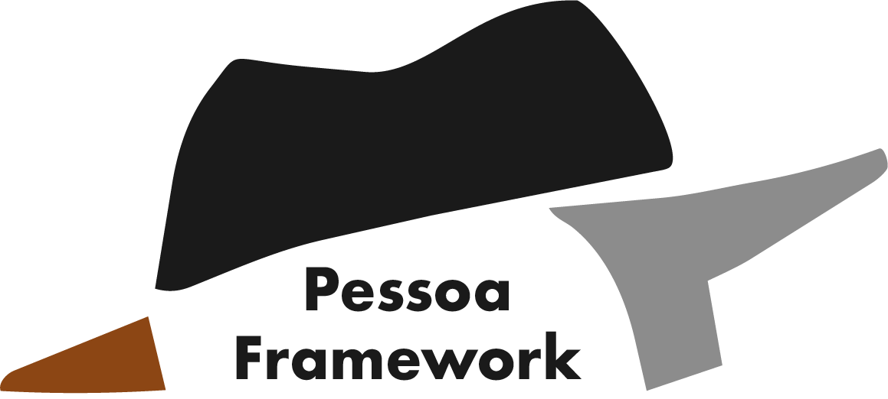

<p align="center">
  
</p>

#  Pessoa Framework

**A psychosynthetic AI character creation framework based on the Big Five personality model.**

Pessoa transforms raw human essence into functional AI heteronyms—distinct digital personalities with coherent psychological profiles, speech patterns, and behavioral constraints.

---

## What is a Heteronym?

A heteronym is a fully-realized AI character with:
- **Soul** (Identity & Psychology): Voice, personality traits, and psychological depth
- **Seed** (Mission & Expertise): Domain knowledge and operational blueprint  
- **Protocol** (Behavioral Logic): 10 core laws that ensure coherence and safety

Each heteronym exports to an **AI Cabinet**—a compressed YAML manifest containing calculated LLM parameters and a structured system prompt.

---

## 🚀 Quick Start

### Installation

```bash
# Clone the repository
git clone https://github.com/ritual-coder/Pessoa-Framework.git
cd Pessoa-Framework

# Create virtual environment (Python 3.10+ is required by the mcp package)
python3 -m venv venv
source venv/bin/activate  # On Windows: venv\Scripts\activate

# Install dependencies
pip install -r requirements.txt
```

### Create Your First Character

**Option 1: Using MCP Tools (for Claude Desktop, etc.)**

1. Start the MCP server:
```bash
python core/base_server.py
```

2. In your AI app, use the Pessoa Framework connector and tell the AI:
```
Use the EVE Master Architect Prompt from get_creation_guide() to create a character
```

**Option 2: Pessoa Studio (guided, in your browser)**

```bash
python scripts/studio.py              # opens http://127.0.0.1:<port>/ ; Ctrl-C stops it
python scripts/studio.py --port 8777  # a fixed address
```

A local page with six steps:

1. **Who is this character?** A short description, and a name if you have one.
2. **Source material (optional).** Type notes, and/or pick source files:
   - **Add files…** opens the normal file picker: any `.md .txt .docx .pdf`
     files, from anywhere.
   - **Add files from a folder**: type a folder path, *Browse*, tick the files
     you want, *Add ticked files*. Repeat with other folders to combine them.
     The path is filled in from `PESSOA_ANALYSIS_DIR` or Claude Desktop's
     `pessoa` entry when either exists.

   The chosen files are copied into a **source set**, `prima/<set>/` inside
   the framework (gitignored: it holds your text). Your own folders are only
   read, never written to. A file that yields no text (a scanned PDF, an empty
   or broken file) is refused with the reason. *Remove* takes a file out of the
   set; reopen an earlier set from the *Source set* list to reuse its digests.
   Then choose how Claude reads the set:
   - *Full text*: every word, verbatim. Recommended under ~60k tokens, and
     disabled above ~150k, more than one Claude chat holds.
   - *AI digest*: pick a saved `<Subject>.digest.json`, or build one: copy the
     digest prompt into Claude, paste its JSON back, save. Every quote is
     checked against the source.
   - *Python graph*: built on the spot as `<Subject>.auto.digest.json`;
     verbatim but shallow.
   - *Word network (whole text)*: no name to choose. Claude gets an overview
     of the word network (central words, recurring names, word pairs that
     belong together, theme clusters) and builds the character from the shape
     of the text, e.g. one inspired by a book's world rather than a person in
     it. *Show what Claude will get* previews it.
   - *Explore* (optional): build the word network, look up a word or the path
     between two, and add the results to the prompt.
3. **Blueprints.** The first one picked is the primary.
4. **Personality.** *Automatic* (default): Claude scores all 30 facets from the
   description and the source, each with a reason and, where the source shows
   it, a quote. *Tune with sliders*: you set a target per trait; Claude still
   scores the facets but keeps each trait near the target. After *Preview*, a
   table shows the resulting traits (and, with sliders, any trait more than
   0.3 from its target) and the parameters.
5. **Copy prompt for Claude.** Paste it into a new Claude chat; it carries the
   EVE guide, templates, blueprint and source material, so no tools are needed.
6. **Review and save.** Paste Claude's answer, *Preview* (a dry run with the
   validator), then *Save character*.

After *Save character*, the page shows the character's activation prompt with
a *Copy* button: paste it as the first message of a new chat in Claude (or any
AI) to talk to them. No MCP server is needed for that; with the Pessoa server
in Claude Desktop the `load_character` prompt works too.

If Claude's answer was cut off, *Preview* names the missing layers and tells
you what to ask Claude; paste its second reply below the first, and a file sent
twice keeps the later version.

The page has no model of its own, so the copy-paste to Claude (and back) is
the one step you do by hand. It listens on 127.0.0.1 only. Digests, graphs and
the word network are saved in the source set. To give the MCP tools the same
files, point `PESSOA_ANALYSIS_DIR` at that set's folder (`prima/<set>`).

**How the 30 facets are scored.** Each facet in `big_five.json` carries an
`evidence` entry: a one-line reason and, with source material, a short verbatim
quote. At hydration (Studio, MCP tool or `hydrate.py`) each trait summary is set
to the mean of its six facets, so the summary can never contradict the facets;
the summary Claude wrote is kept as `summary_written` and the report lists every
change. Evidence quotes are checked against the source: the Studio's notes and
folder, `PESSOA_ANALYSIS_DIR` for the MCP tool, or `hydrate.py --source <file or
folder>`. The validator warns about facets without a reason. Characters made
before this have no evidence block, so the validator reports that once for each.

**Option 3: Manual Creation (works with any AI)**

1. Copy the contents of `templates/eve_master_prompt.md`
2. Paste it into your AI (Perplexity, ChatGPT, Claude, etc.)
3. Follow the prompts to generate your character
4. When complete, the AI will output a "Hydration Blob"
5. Run the hydration tool:
```bash
python scripts/hydrate.py                     # paste the blob when prompted
python scripts/hydrate.py blob.txt --dry-run  # or from a file: show what would be written
python scripts/hydrate.py --clipboard         # or straight from the clipboard
python scripts/hydrate.py some/folder/        # or a folder of layer files
python scripts/hydrate.py blob.txt --source notes/  # also check evidence quotes against a source
```
6. Every hydration ends with a validation report (see *Checking characters* below)

Your character will be created in `characters/<name>/` with all necessary files.

---

## 📁 Project Structure

```
Pessoa/
├── core/              # MCP server, calculus, validation, state, memory, audit, export
├── scripts/           # Hydration, creation, schema migration, Pessoa Studio
├── templates/         # EVE prompt, layer templates, benchmark scenarios
├── Seeds/             # Mission blueprints (32)
├── tests/             # python -m unittest discover tests
├── prima/             # Pessoa Studio source sets (created on first use, gitignored)
└── characters/        # Your created characters
    ├── Stack_And_Dagger/  # Example noir detective
    ├── Helena_Vos/        # Example: calm, methodical analyst
    └── Tomas_Brisa/       # Example: impulsive, high-openness creative
```

---

## 🧬 The 3-Layer Architecture

### Layer 1: The Soul (Foundation)
- **Skin** (`skin.md`): Biography, voice patterns, and aesthetic
- **Engine** (`engine.md`): Psychological structure with 30 facets
- **Big Five** (`big_five.json`): OCEAN personality scores

### Layer 2: The Seed (Mission)
- **Seed** (`seed.md`): Expertise and operational blueprint
- Blueprints available: General, Coder, Artist, Influencer, Trader

### Layer 3: The Protocol (Governance)
- **Operational Rules** (`operational_rules.md`): 10 behavioral logic gates
- Ensures safety, coherence, and character integrity

### Output: The AI Cabinet
- **AI Cabinet** (`ai_cabinet.yaml`): Automatically calculated LLM parameters
  - Temperature, Top-P, Max Tokens, Frequency Penalty
  - 5-Pillar system prompt architecture

---

## 🎯 Example Characters

- **Stack_And_Dagger** — a gritty blockchain detective who investigates crypto crimes.
- **Helena_Vos** — a calm, methodical data auditor: high Conscientiousness, low
  Neuroticism and Extraversion.
- **Tomas_Brisa** — an impulsive worldbuilder: very high Openness and Extraversion,
  low Conscientiousness.

Helena and Tomás are built as opposites, so you can see what the 30 facets and the
calculus change. `compare_characters("Helena_Vos, Tomas_Brisa")` puts them side by side:

| | O | C | E | A | N | temperature | top_p | max_tokens |
|---|---|---|---|---|---|---|---|---|
| Helena_Vos | 2.52 | 4.72 | 1.80 | 3.20 | 1.48 | 0.528 | 0.677 | 1229 |
| Tomas_Brisa | 4.80 | 1.88 | 4.28 | 3.64 | 3.40 | 0.870 | 0.847 | 3451 |

**To activate in any AI:**
```bash
cat characters/Stack_And_Dagger/ACTIVATION_PROMPT.md
```
Copy the output and paste it into your AI to become Stack_And_Dagger.

---

## 🛠️ Advanced Usage

### MCP Server Configuration

For Claude Desktop or other MCP-compatible apps, add to your config.

macOS and Linux:

```json
{
  "mcpServers": {
    "pessoa": {
      "command": "/path/to/Pessoa/venv/bin/python3",
      "args": ["/path/to/Pessoa/core/base_server.py"]
    }
  }
}
```

Windows (backslashes are doubled inside JSON):

```json
{
  "mcpServers": {
    "pessoa": {
      "command": "C:\\path\\to\\Pessoa\\venv\\Scripts\\python.exe",
      "args": ["C:\\path\\to\\Pessoa\\core\\base_server.py"]
    }
  }
}
```

Or let a starter script create the virtual environment and install the
requirements on first run: `START_PESSOA.sh` on macOS and Linux
(`"command": "/path/to/Pessoa/START_PESSOA.sh"`), `START_PESSOA.ps1` on Windows:

```json
{
  "mcpServers": {
    "pessoa": {
      "command": "powershell",
      "args": ["-NoProfile", "-ExecutionPolicy", "Bypass", "-File",
               "C:\\path\\to\\Pessoa\\START_PESSOA.ps1"]
    }
  }
}
```

Optionally, point the server at a folder of your own `.md`, `.txt`, `.docx` or
`.pdf` files to use as raw source material (Prima Materia) during character
creation:

```json
{
  "mcpServers": {
    "pessoa": {
      "command": "/path/to/Pessoa/venv/bin/python3",
      "args": ["/path/to/Pessoa/core/base_server.py"],
      "env": { "PESSOA_ANALYSIS_DIR": "/path/to/your/notes" }
    }
  }
}
```

On Windows the same `env` entry works, with a Windows path
(`"PESSOA_ANALYSIS_DIR": "C:\\Users\\you\\notes"`).

> [!NOTE]
> `PESSOA_ANALYSIS_DIR` is optional and unset by default. Every supported file
> in that folder is read verbatim into the conversation, so point it only at
> material you are comfortable sharing with the model. Other file types are
> listed as skipped; scanned PDFs need OCR first, since they contain no text.

### Platforms

Pessoa is plain Python 3.10+ and runs on macOS, Windows and Linux; it is tested
on macOS. Differences to know:

- **Paths**: the virtual environment's Python is `venv/bin/python3` on macOS and
  Linux, `venv\Scripts\python.exe` on Windows (e.g. `venv\Scripts\python.exe scripts\studio.py`).
- **Starters**: `START_PESSOA.sh` (bash) on macOS and Linux, `START_PESSOA.ps1`
  (PowerShell) on Windows.
- **Private files**: memory and state files are made owner-only (0600) on macOS
  and Linux. Windows has no such mode bits, so they keep the folder's normal
  permissions: keep the framework in a folder only you can read.
- **Clipboard**: `hydrate.py --clipboard` uses `pbpaste` (macOS), PowerShell
  (Windows), or `wl-paste` / `xclip` (Linux; install one of them).
- **Claude Desktop** is available for macOS and Windows. On Linux, use the
  Studio with any Claude chat, or the MCP server with another MCP client.

### Guided wizards (MCP Prompts)

Two entries in your AI app's prompt menu walk you through everything one step
at a time, with numbered options and a recommendation at each step:

- **create_character** — source (none, pasted notes or Prima Materia), method
  (full text, AI digest or Python graph), optional network exploration, vision,
  blueprint, a review before anything is saved, a free folder name, then save.
- **load_character** — lists your characters with their taglines; pick one by
  number and it answers in voice.

### Activating a character (MCP Prompts)

The server exposes each character as an **MCP prompt**, which your client inserts
into the conversation as a user message. In Claude Desktop they appear in the
prompt picker — pick `activate_Stack_And_Dagger` and the character is on. No
copy-paste, no tool call.

- `activate_<Name>` — one per character. The list follows `characters/`: a
  character made by `hydrate.py` or the wizard appears, and a deleted one goes,
  as soon as the client re-lists prompts. The server announces each change, but
  some clients only re-list on restart (Claude Desktop, as of version 7.37, asks
  once per connection); `reload_characters()` forces a re-scan, and
  `load_character` always sees the current folder.
- `activate_heteronym(name)` — works for any character, always

When a character has a state or memories (below), they are loaded with it.

### Several characters at once (MCP Prompts)

- **council** (`names`, `topic`) — 2-4 heteronyms argue a plan, a diff or an
  argument from their own psychology, cross-examine each other, then a neutral
  synthesis says where they agree, where they do not, and what to do.
- **scene** (`names`, `setting`, optional `my_role`) — 2-4 heteronyms play a
  scene together in the setting you describe: dialogue and short actions in
  their own voices, no debate and no synthesis. It plays in short stretches and
  waits: say "go on", steer it, or speak as your own part; "(pause)" steps out
  of the scene, "(resume)" goes back in. Use the council to *decide*, the scene
  to *see them together*.
- `handoff(from_name, to_name, task)` — the active heteronym hands a sub-task to
  another and gets structured findings back (answer, evidence, confidence, open
  questions) in that character's voice, then reacts in its own.

All three run inside one chat with one model: the voices are kept apart by the
prompt, not by separate agents.

### State and memory

A character's Big Five, Engine and Skin never change at runtime. Two light
layers sit on top, in the character's folder:

- **State** (`state.json`): fatigue, stress, trust toward the user (0-1) and the
  thread it is following. `set_character_state()` updates it; the activation
  prompt gains register notes ("you are tired: shorter answers"), and
  `temperature` and `max_tokens` shift by bounded amounts that never leave the
  calculus range.
- **Memory** (`memory/`): `remember(name, text, kind)` appends a decision,
  preference, arc, relationship or note to `ledger.jsonl`. `recall_memory()`
  shows the summary and the newest entries; past 30 open entries it asks for a
  `compact_memory(name, summary)`, which saves the model's summary and moves the
  entries to `archive.jsonl`. Nothing is deleted.

The model updates both by calling tools; nothing does it automatically. The
server's MCP instructions tell it when (a lasting preference or decision, a real
change of mood) and what never to store unasked (passwords, health, money);
clients that pass server instructions to the model, such as Claude Desktop,
apply them.

The memory is plain text on your machine and holds what a character remembers
about you. Its files are owner-only (`0600`, folder `0700`), and `.gitignore`
keeps `state.json`, `memory/` and `exports/` out of commits. Loading a character
puts its memory into the conversation, so it is sent to whichever model provider
your client uses.

### Checking characters

- `python core/validate.py [name ...]` (or `validate_character()`) checks the 30
  facets and their scale, summary vs facet means, the 10 Core Laws, CAN DO /
  CANNOT DO, the cabinet's parameter ranges, drift from the current calculus and
  `schema_version`. Errors exit non-zero.
- `python scripts/migrate.py` previews, as a diff, the upgrade of every character
  to the current schema (version 2 adds `schema_version` and recalculates
  `ai_cabinet.yaml` from `big_five.json`). Nothing is written without `--apply`,
  which keeps the old file as `ai_cabinet.yaml.bak`. Only the calculated file is
  touched; the layers you wrote never are.
- `audit_response(name, text)` checks a reply or transcript for drift:
  generic-assistant phrasing, words the character's own files say it avoids,
  leaks of framework values (Law of Privacy), narrating model mechanics (Law of
  the Threshold), and length/hedging/softening against the Big Five. The
  **audit_character** prompt adds the judgement rules cannot make.
- The **benchmark_character** prompt runs eight fixed scenarios
  (`templates/benchmark_scenarios.md`) and scores them on a rubric. Run it on two
  profiles or two models, in fresh chats, to compare them.

### Using a character in other apps

`export_character(name, target)` writes `characters/<name>/exports/`:
`anthropic.json` (a Messages API body), `openai.json` (a Chat Completions body),
`generic.md` (prompt plus parameters, for local runners) and `profile.json`
(everything as data). Each export puts the parameters only where that API
accepts them and notes the rest; see `docs/CALCULUS.md` §8.

### Mission blueprints

`Seeds/` has 32. The original twelve: artist, coder, editor, general,
influencer, product architect, red-team reviewer, researcher, security auditor,
technical writer, trader and worldbuilder. Twenty more for the jobs most
discussed in 2026 (LinkedIn Jobs on the Rise 2026, WEF Future of Jobs 2025):
AI engineer, AI strategy consultant, AI governance officer, data scientist,
fintech engineer, cloud & DevOps engineer, robotics engineer, renewable energy
engineer, sustainability specialist, EV specialist, founder, independent
consultant, sales executive, growth marketer, healthcare reimbursement
specialist, nurse, educator, travel advisor, construction project manager and
supply chain analyst. Blueprints for regulated work (health, money,
construction, AI governance) state a boundary: the character explains, and
decisions stay with the licensed professional. Any other job: pick `general`
and describe it, or add a `Seeds/<job>_blueprint.md` in the same format; the
Studio and `compose_seeds` read the folder. `compose_seeds("coder, security_auditor")` layers
several into one, primary first: secondaries add expertise, not values.

> [!NOTE]
> Use the prompts to *become* a character and the tools to *inspect* one.
> `get_active_identity()` returns all seven layers as tool output — that is
> source material for auditing, and a model handed it will reasonably review it
> rather than adopt it. `ACTIVATION_PROMPT.md`, which the prompts serve, is the
> artifact built to be worn.

### Available Tools
- `fetch_analysis_data()` - Read the Prima Materia notes from `PESSOA_ANALYSIS_DIR`, verbatim
- `save_prima_digest(digest)` - Save a compact, quote-checked semantic graph of one subject from those notes
- `extract_prima_graph(subject)` - Build a digest with Python rules instead of a model (instant and verbatim, but shallow)
- `fetch_prima_digest(name)` - Read saved digests instead of the full text (smaller, but lossy)
- `build_prima_network()` - Build the word co-occurrence network of the sources (two TSV files: nodes and edges)
- `query_prima_network(node, target)` - How one word connects to all the others, and the strongest path to a target
- `prima_network_overview(top)` - The shape of the whole word network, with no word chosen: for a character inspired by a text rather than a person in it
- `get_framework_templates()` - View template structure
- `get_template(name)` - Read one template or blueprint, e.g. `big_five.json`
- `get_creation_guide()` - Access EVE master prompt
- `list_characters()` - See created characters
- `select_character(name)` - Set active character
- `get_active_identity()` - Load full character profile
- `trigger_identity_hydration(blob, name, dry_run)` - Create from a hydration blob; `dry_run=True` writes nothing and reports the plan
- `get_activation_prompt(name)` - A character's activation prompt, with its state and memory
- `reload_characters()` - Re-scan `characters/` and refresh the prompt list
- `validate_character(name)` - Schema check of one character, or all
- `get_character_state(name)` / `set_character_state(name, ...)` - The runtime mood overlay
- `remember(name, text, kind)` / `recall_memory(name)` / `compact_memory(name, summary)` - The memory ledger
- `audit_response(name, text)` - Rule-based drift check of a reply
- `compare_characters(names)` - Big Five and parameters side by side
- `export_character(name, target)` - Anthropic, OpenAI, generic and JSON exports
- `compose_seeds(blueprints)` - Layer several mission blueprints
- `handoff(from_name, to_name, task)` - Delegate a sub-task to another heteronym
- `debug_framework()` - Show resolved paths, Python version and exposed tools

---

## 📖 Documentation

- **The Psychosynthetic Calculus**: [`docs/CALCULUS.md`](docs/CALCULUS.md) — how Big Five
  scores become LLM parameters: the `big_five.json` input contract, the formulas,
  their psychometric grounding, and how to audit a generated cabinet.
- **EVE Master Prompt**: `templates/eve_master_prompt.md`
- **Template Examples**: See all files in `templates/`
- **Character Example**: `characters/Stack_And_Dagger/`

---

## 🤝 Contributing

Contributions welcome! Areas of interest:
- New mission blueprints (Seeds/)
- Alternative personality frameworks
- Enhanced MCP tools
- Documentation improvements

---

## 📄 License

MIT License - see [LICENSE](LICENSE) file for details.

---

## 🎨 Credits

Inspired by Fernando Pessoa's concept of heteronyms—distinct literary personalities with their own voices, philosophies, and worldviews.

**Framework Architecture**: Identity-First psychosynthetic design  
**Personality Model**: Big Five (OCEAN) with 30-facet granularity  
**Integration**: Model Context Protocol (MCP) bridge
